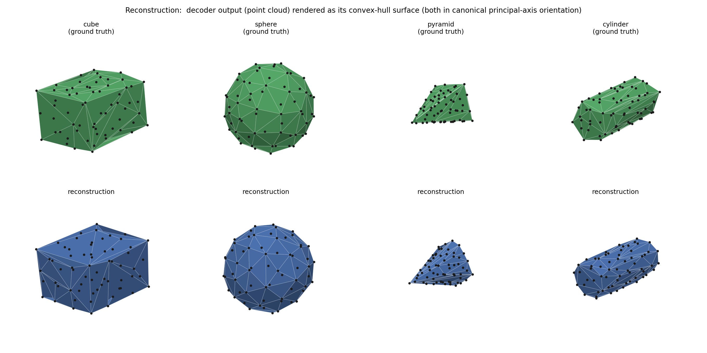

# ShapeEmbed experiments

Experiments with [ShapeEmbed](https://github.com/uhlmanngroup/ShapeEmbed) on MNIST and BBBC010, plus a small extension to unordered 3D surface points.

The 2D pipeline turns a binary mask into a sampled contour, a normalized distance matrix, and a 128-dimensional shape embedding. The experiments compare VAE, AE, and MLP-decoder variants; the 3D extension tests what happens when surface points have no fixed order.



*Ground truth above, decoded point clouds below, shown as convex hulls. These are saved results on four synthetic shape families.*

The project includes:

- **2D experiments:** VAE, AE, and MLP-decoder variants on MNIST and BBBC010.
- **3D prototype:** a permutation-invariant set encoder, compared with CNN and MLP encoders.
- **Extension ideas:** topology-aware shape representations and a shape prior for segmentation, described in [notes.md](notes.md). These are proposals, not trained models.

## Run it

Use Python 3.11. Dependencies were tested on macOS and Linux with CPU.

```bash
python3.11 -m venv .venv
source .venv/bin/activate
pip install -r requirements.txt
```

For a 2D MNIST experiment:

```bash
python run.py --dataset mnist --model vae --mode preprocess
python run.py --dataset mnist --model vae --mode train
python run.py --dataset mnist --model vae --mode evaluate
python run.py --dataset mnist --model vae --mode figures
```

Models are `vae`, `ae`, and `mlp_decoder`; datasets are `mnist` and `bbbc010`. For BBBC010, run `--mode organize` first to download and arrange the masks. Run preprocessing for each dataset/pipeline; the MNIST VAE and AE share one cache, while the MLP-decoder path uses another. Training accepts `--epochs`, `--batch-size`, and `--device cpu|mps|cuda|auto`; the default is 350 epochs.

For a quick 3D demo with generated data:

```bash
python phase3/generate_dataset.py --per-class 20 --n-points 16
python phase3/train.py --encoder set --features both --latent-dim 8 --epochs 1 --batch-size 8 --device cpu --tag demo
python phase3/evaluate.py --run set_both_demo --device cpu
```

The one-epoch demo checks the pipeline; it does not reproduce the saved 350-epoch results. Data and outputs are written under `data/` and `outputs/`. Generating a new 3D dataset replaces the previous local dataset. More 3D options are in [phase3/README.md](phase3/README.md).

## Results and files

The saved 3D experiment shows the set encoder staying stable when input points are reordered, while CNN and MLP descriptors change substantially. See [results](results/README.md) for the numbers and evaluation limitations.

- `src/`: main 2D implementation.
- `legacy/shapeembed/`: earlier MNIST VAE/AE implementation.
- `phase3/`: synthetic 3D experiments.
- `results/`: saved metrics and summary tables.
- `figures/`: selected plots and examples.

## Credits

Based on A. Foix-Romero, C. Russell, A. Krull, and V. Uhlmann, *ShapeEmbed: a self-supervised learning framework for 2D contour quantification*, NeurIPS 2025 ([paper](https://openreview.net/forum?id=iT2ZisemFs)). The legacy model and related routines adapt the [official ShapeEmbed code](https://github.com/uhlmanngroup/ShapeEmbed); preprocessing also references [ConvertBinaryMasksToDMs](https://github.com/uhlmanngroup/ConvertBinaryMasksToDMs). This repository contains my experiments and extensions of that work.

[MIT license](LICENSE), including the original Uhlmann Group copyright. BBBC010 masks are provided by Fred Ausubel / the [Broad Bioimage Benchmark Collection](https://bbbc.broadinstitute.org/BBBC010), CC0; the dataset requests citation of Ljosa et al., *Nature Methods* (2012). MNIST is accessed through torchvision. Raw datasets and pretrained weights are not bundled.
