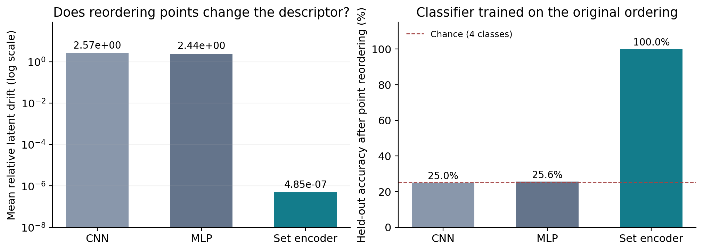
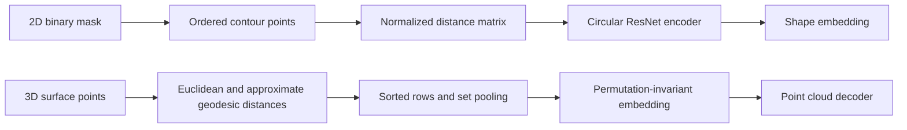

# ShapeEmbed Experiments

**Learning shape representations from 2D contours to unordered 3D surfaces.**

Reproduction experiments, architecture ablations, and extensions of [ShapeEmbed](https://github.com/uhlmanngroup/ShapeEmbed), by **Reza Dadbin**. Based on Foix-Romero et al., *ShapeEmbed: a self-supervised learning framework for 2D contour quantification*, NeurIPS 2025 ([paper](https://openreview.net/forum?id=iT2ZisemFs)).


*Archived 3D experiment: ground truth above, decoded point clouds below. Surfaces are convex hulls; both rows use a canonical principal-axis orientation.*

## What is in this project?

| Part | Work | Status |
| --- | --- | --- |
| 2D shape learning | Contour-to-distance-matrix preprocessing; VAE, deterministic AE, and MLP decoder experiments on MNIST and BBBC010 | Implemented; archived metrics included |
| SurfaceGraph-ShapeEmbed | Permutation-invariant set encoder for 3D surface distances, with CNN/MLP baselines and point/matrix decoder ablations | Implemented synthetic proof of concept |
| TopoShapeEmbed | Multi-contour representation, nesting graph, topology-conditioned decoding, and preservation objectives | Design proposal with geometric illustrations |
| Segmentation | Using shape embeddings as an auxiliary shape prior | Research note |

The original ShapeEmbed method belongs to its authors. This repository documents my experiments and extensions and retains upstream attribution; it is an experimental research project rather than an exact replication of every paper setting.

## A result worth looking at

On four synthetic 3D shape families, reordering the input points barely changes the set encoder's descriptor. The same operation substantially changes the CNN and MLP descriptors.



| Encoder | Mean relative latent drift ↓ | Held-out accuracy with reordered inputs ↑ |
| --- | ---: | ---: |
| CNN | 2.57 | 25.0% |
| MLP | 2.44 | 25.6% |
| Set encoder | 4.85 × 10⁻⁷ | 100.0% |

These are **archived results on a simple four-class synthetic dataset**, not a general 3D recognition benchmark. The classifier is fitted on original-order training embeddings and evaluated on reordered test embeddings. See [the full results and protocols](docs/results.md) for all eight 3D runs, six 2D runs, and the limitations of the older evaluation setup.

## Try the 3D pipeline

Use **Python 3.11**. The synthetic demo needs no external dataset or pretrained weights.

```bash
python3.11 -m venv .venv
source .venv/bin/activate
python -m pip install -r requirements.txt

# Small end-to-end demonstration; increase epochs for meaningful reconstructions.
python phase3/generate_dataset.py --per-class 20 --n-points 16
python phase3/train.py --encoder set --features both --latent-dim 8 --epochs 1 --batch-size 8 --device cpu --tag demo
python phase3/evaluate.py --run set_both_demo --device cpu
```

Results and figures appear in `outputs/shapes3d/`. The one-epoch command demonstrates the software pipeline; it does not reproduce the archived 350-epoch results. Dataset generation replaces local `data/processed/shapes3d/{train,test}.npz`, so use a separate checkout for separate dataset configurations.

For the full 64-point experiment and ablations, see [the 3D guide](phase3/README.md). For 2D commands, device selection, and exact preprocessing conventions, see [reproducibility](docs/reproducibility.md).

## How it works



The 2D loss minimizes reconstruction error over cyclic shifts and traversal reversal. The 3D set encoder handles arbitrary point permutations by sorting each distance row and pooling shared node features. Its default decoder emits coordinates, ensuring that decoded distances come from a 3D point cloud. [Method details](docs/method.md).


*BBBC010 preprocessing: individual-worm mask → contour → 64 sampled points → normalized distances. Image credit: Fred Ausubel / Broad Bioimage Benchmark Collection, BBBC010 v1, CC0.*

## Explore

- [Results and evaluation protocols](docs/results.md)
- [Reproduction instructions and tested environment](docs/reproducibility.md)
- [2D and 3D methods](docs/method.md)
- [TopoShapeEmbed design proposal](docs/toposhapeembed.md)
- [Segmentation extension](docs/segmentation.md)
- [Credits, data sources, and third-party notices](THIRD_PARTY_NOTICES.md)

```text
run.py                 Unified 2D command line
src/                   Main 2D models, training, evaluation, and figures
legacy/shapeembed/      Earlier MNIST VAE/AE implementation
phase3/                Synthetic 3D generation, models, training, and evaluation
results/archived/      Historical JSON metrics and 3D training histories
scripts/               Result tables and reproducible result plotting
docs/                 Methods, research notes, and selected figures
tests/                 Geometry, model-gradient, and presentation checks
```

## Checks

```bash
python -m unittest discover -s tests -v
python scripts/summarize_results.py --check
```

Local CPU verification covers geometry invariants, reconstruction losses, finite model gradients, deterministic VAE evaluation, and faithful figure sampling. The 3D pipeline has also been checked end to end on a small generated dataset. Full 350-epoch runs have not been repeated for this cleaned release. [Validation details](docs/reproducibility.md#validation).

## License and citation

Code and project documentation are under the [MIT license](LICENSE), with the original Uhlmann Group copyright retained for adapted code. Datasets have their own terms; raw datasets and checkpoints are not bundled. The small BBBC010 figure is credited above and in [the notices](THIRD_PARTY_NOTICES.md).

If you build on this work, cite the original [ShapeEmbed paper](https://openreview.net/forum?id=iT2ZisemFs). This repository also includes [CITATION.cff](CITATION.cff).
