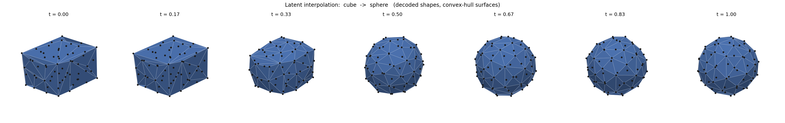

# Archived experimental results

The JSON records in `results/archived/` come from saved project experiments. Numeric values are preserved. Absolute checkpoint paths were made relative, and JSON formatting was normalized. The [manifest](../results/archived/manifest.json) records source and published hashes. These results were not regenerated by full training for the cleaned release, and the exact original package environment is not recorded.

## 2D classification

The tables below use logistic-regression **macro F1** on frozen embeddings, rather than mixing accuracy with F1. Standard deviations describe classifier folds from one trained encoder; they are not uncertainty across independently trained models.

| Dataset | Variant | Macro F1, mean ± fold std |
| --- | --- | ---: |
| MNIST | VAE, legacy pipeline | 0.9498 ± 0.0014 |
| MNIST | AE, legacy pipeline | 0.9446 ± 0.0011 |
| MNIST | MLP decoder, main pipeline | 0.9016 ± 0.0020 |
| BBBC010 | VAE, main pipeline | 0.8206 ± 0.0173 |
| BBBC010 | AE, main pipeline | 0.8310 ± 0.0215 |
| BBBC010 | MLP decoder, main pipeline | 0.8313 ± 0.0142 |

[Machine-readable 2D table](../results/2d_summary.csv). The two MNIST implementations use different normalization and decoder paths; the three MNIST rows are not a controlled one-component comparison.

The main BBBC010 records also include the original size norm as one additional feature:

| BBBC010 variant | Shape only | Shape plus size |
| --- | ---: | ---: |
| VAE | 0.8206 | 0.8185 |
| AE | 0.8310 | 0.8225 |
| MLP decoder | 0.8313 | 0.8254 |

Size does not improve macro F1 in these saved runs. No statistical superiority is claimed for the small differences between BBBC010 variants.

### 2D protocol and limits

The encoder is trained once, then training and test embeddings are pooled for five-fold downstream classification. The encoder is not retrained inside each fold, so classifier test folds can contain images seen during unsupervised encoder training. This is a pooled frozen-representation evaluation, not a strict held-out inductive benchmark. The legacy classifier uses standardization fitted inside each classifier fold; the main 2D classifier uses unstandardized embeddings.

MNIST uses a new stratified split of the combined 70,000 images rather than the official 60,000/10,000 benchmark partition. BBBC010 has 1,407 individual-worm masks; splitting is at the worm-image level, not grouped by well or acquisition. Shared acquisition context may therefore cross partitions.

The historical legacy MNIST trainer used `test.pt` as validation to choose the best checkpoint. The cleaned trainer now reserves 15% of `train.pt` for validation and does not use `test.pt` for checkpoint selection. Archived scores retain the older limitation. The main 2D trainer selects its checkpoint by training loss and has no separate validation subset.

The cleaned code also changes evaluation sampling and plotting defaults. It preserves checkpoint architectures, but the archived numbers should not be read as guaranteed exact outputs of a fresh run of the cleaned source. Raw datasets and old checkpoints are not part of this repository.

## 3D permutation experiment

All eight archived runs use 64 points, latent dimension 128, 350 epochs, and seed 42 on four synthetic families. The generator's default creates 800 samples and splits them 80/20. Archived training used `val_frac=0` and selected checkpoints by training reconstruction error; current training defaults to a 15% validation subset.

| Run | Relative latent drift ↓ | Accuracy on reordered test inputs ↑ | Sorted-distance test MSE ↓ |
| --- | ---: | ---: | ---: |
| CNN, both distances | 2.573 | 0.2500 | 2.48 × 10⁻⁸ |
| MLP, both distances | 2.438 | 0.2563 | 4.36 × 10⁻⁷ |
| Set, both distances | 4.85 × 10⁻⁷ | 1.0000 | 2.64 × 10⁻⁸ |
| Set AE, both distances | 4.49 × 10⁻⁷ | 1.0000 | 1.08 × 10⁻⁸ |
| Set, Euclidean only | 5.30 × 10⁻⁷ | 1.0000 | 2.76 × 10⁻⁸ |
| Set, geodesic only | 9.33 × 10⁻⁷ | 1.0000 | 2.80 × 10⁻⁸ |
| Set, matrix decoder + validity penalty | 1.81 × 10⁻⁷ | 1.0000 | 1.75 × 10⁻⁵ |
| Set, matrix decoder without validity penalty | 1.55 × 10⁻⁷ | 1.0000 | 2.84 × 10⁻⁵ |

[Machine-readable 3D table](../results/3d_summary.csv). The matrix decoder's saved Gram-validity residual is `1.11e-6` with the penalty versus `9.81e-6` without it. This is one ablation run per configuration, not a significance test.

### What each metric measures

**Latent drift** is the mean test-sample ratio `||z_permuted - z_original||₂ / (||z_original||₂ + 1e-9)`. Each sample receives an independent point permutation applied to both matrix dimensions and all channels.

**Reordered-input accuracy** fits a standardized logistic classifier on original-order training embeddings and scores reordered test embeddings. Chance accuracy for the balanced four-class test set is 25%.

**Frozen-embedding CV accuracy** in the JSON files is a separate five-fold classifier evaluation within the test embeddings. It is 100% for all eight runs. The class families are deliberately easy to distinguish, making permutation robustness more informative than that headline score.

**Test reconstruction MSE** compares sorted upper-triangle distances. It does not measure point correspondence, mesh quality, or topology preservation. The extra point-matching term used during training is not included in this reported MSE. Normalization makes absolute distances small, so tiny errors should not be interpreted without the metric definition.

The results support the intended point-order invariance on this controlled dataset. They do not establish real-world 3D recognition, arbitrary-surface reconstruction, robustness to scans, or preservation of holes and disconnected components.



*Archived decoded interpolation, rendered as convex hulls. This is a qualitative example, not a topology-preservation experiment.*

## Rebuild the tables and chart

```bash
python scripts/summarize_results.py
python scripts/plot_results.py
python scripts/summarize_results.py --check
```

The summarizer verifies the archived-file hashes and derives both CSV tables directly from the saved JSON. The chart uses only the three corresponding encoder evaluation records.
