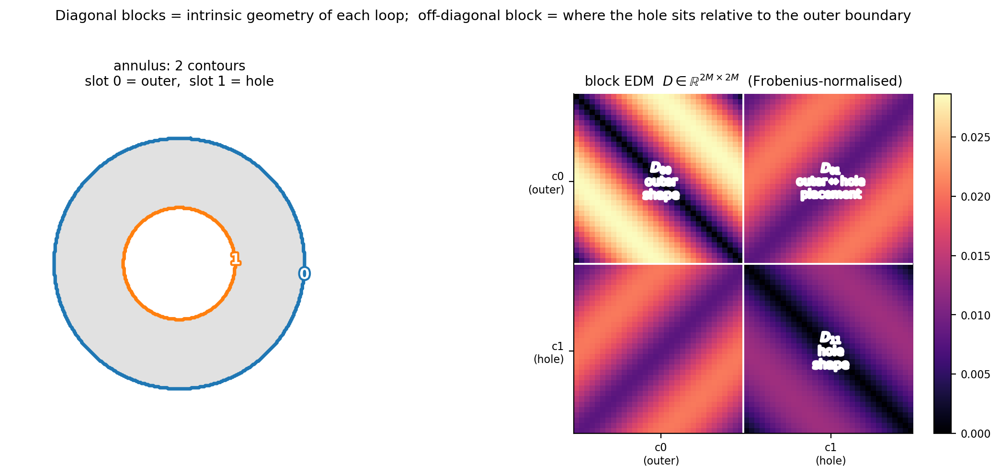
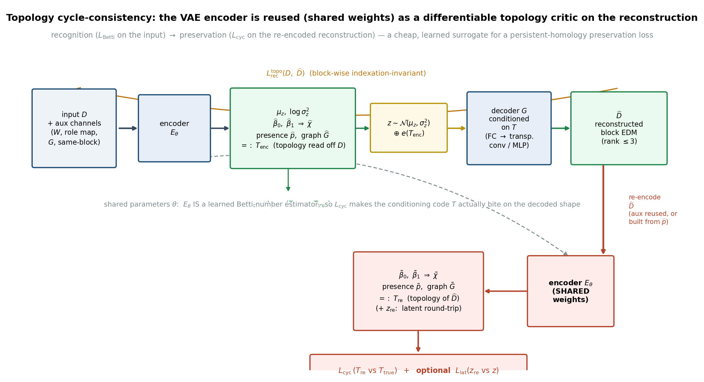

# TopoShapeEmbed: a topology-aware design proposal

**Status: proposed architecture and geometric illustrations. No topology-aware network has been trained or evaluated in this repository.**

The implemented 2D pipeline retains one outer contour. It cannot distinguish an annulus from a disk using that outer contour alone, and it can discard disconnected components. The 3D prototype also uses convex-hull rendering, which does not preserve cavities or handles. TopoShapeEmbed asks how the representation, latent space, decoder, and losses would need to change.

## Represent all boundary loops

Extract every relevant boundary contour and its containment relation. Type contours as outer boundaries or holes, resample each to `M` points, and pad to a contour budget `K` with an explicit presence mask. The result is a block distance matrix: diagonal blocks describe individual loops, while off-diagonal blocks preserve their relative position.

*Geometric illustration of contour extraction and roles; no neural predictions are shown.*

A nesting graph records which hole belongs to which foreground component. For planar masks, keep a topology code `T = (β₀, β₁, G)`: the component count, hole count, and nesting graph. Derive the Euler characteristic as `χ = β₀ − β₁`; do not predict an independent, potentially inconsistent value.

*Computed distances for a synthetic annulus. This verifies the representation construction, not a learned reconstruction.*

A full boundary-distance matrix can recover boundary point geometry up to rigid motion/reflection when it is a valid 2D Euclidean distance matrix. It does not identify foreground occupancy or hole semantics without contour roles and nesting information. MDS alone is therefore insufficient for topology-aware decoding.

## Separate topology and geometry

Use a discrete topology code `T` and a continuous geometry code `z`. The geometry encoder could process masked block distances, with additional heads predicting components, holes, contour presence, and nesting relations. Feed an embedding of `T` into the decoder alongside `z`.

Conditioning gives the decoder information about the requested topology, but it does not guarantee that the output obeys it. An implementation would need a topology-valid output parameterization or an independently checked reconstruction constraint.

## Preserve topology through the reconstruction

The proposed objective combines:

- a masked distance-reconstruction loss;
- supervision for topology counts, contour presence, and graph relations;
- cycle consistency between the input topology and topology re-estimated from the reconstruction;
- optionally, a differentiable persistent-homology loss on a reconstructed filled mask or occupancy field.

*Architecture schematic. The neural modules and losses shown here are proposed, not implemented.*

A learned topology critic can be wrong or exploited; agreement with that critic is not proof of preservation. Evaluation should compute connected components and holes directly from rasterized reconstructions, using documented connectivity and threshold conventions. Persistent homology on boundary points alone measures the topology of the sampled boundary rather than that of the filled object.

## Generalize indexation invariance

Each contour permits cyclic shifts and traversal reversal. Equivalent contour slots can also be permuted, provided that roles and graph relations are respected. A reconstruction objective should minimize over this structured symmetry group while ignoring padded slots.

Exact enumeration becomes expensive as the number of contours grows. Practical approaches include canonical slot ordering, role-constrained assignment, or set/graph encoders. Canonicalization can be unstable around ties, and approximate matching weakens an exact invariance claim.

## Experiments that would establish the idea

Start with synthetic disks, annuli, multi-hole objects, disconnected disks, and disconnected rings. Report component/hole accuracy, graph-relation accuracy, geometric reconstruction, and the fraction of decoded shapes whose measured topology matches the input. Compare single-contour, multi-contour, topology-head, conditioned-decoder, and preservation-loss variants.

For MNIST, derive topology from the binary mask rather than digit identity: a broken zero may have no hole. Interpolate geometry within a fixed topology stratum separately from transitions between strata. Crossing strata necessarily involves a discrete event such as a merge or hole collapse.

Open issues include finite contour budgets, noise-sensitive hierarchy extraction, variable numbers of loops, nonconvex decoding, differentiable rasterization, and the computational cost of matching. The illustrations here motivate a research direction; they are not performance evidence.
