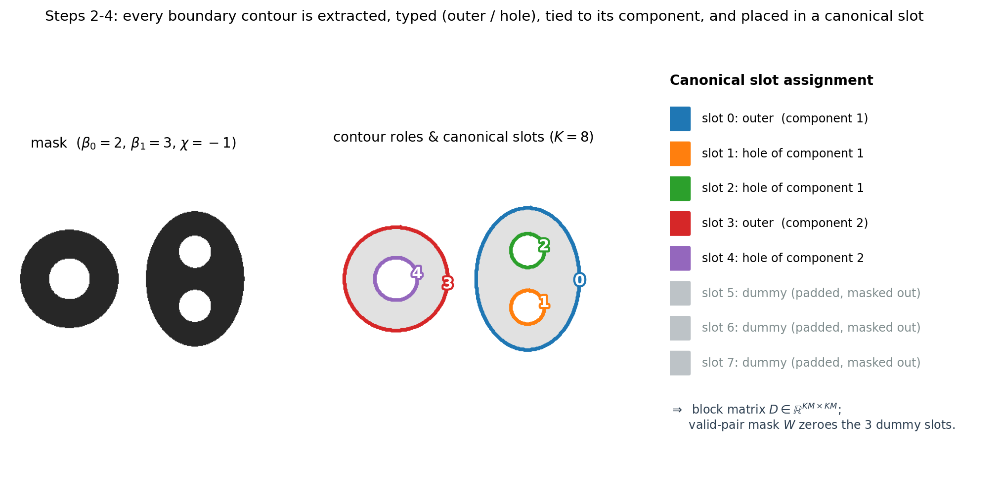

# Extension ideas

These are ideas developed alongside the experiments. Neither a topology-aware network nor a segmentation model is implemented or trained here.

## TopoShapeEmbed

The 2D pipeline represents one outer contour, so it misses holes and can discard disconnected components. A topology-aware extension could retain every boundary loop, its outer/hole role, and a nesting graph.



*Geometric illustration, not neural-network output.*

Resampling each loop gives a block distance matrix: within-loop blocks describe individual boundaries, and cross-loop blocks describe their relative placement. Padding would need an explicit presence mask. The geometry code could be paired with a discrete topology code containing the component count, hole count, and nesting graph. For planar objects, derive the Euler characteristic from `χ = components − holes`.

A decoder conditioned on that code could be trained with masked reconstruction, topology supervision, and a cycle-consistency term that checks the decoded topology. Conditioning alone does not guarantee preservation, and a learned topology critic can make mistakes. Evaluation would need direct component/hole measurements from reconstructed masks. Persistent-homology losses would need to describe the filled shape, not just its sampled boundary.

The main unresolved parts are variable contour counts, stable hierarchy extraction, matching equivalent loops, differentiable rasterization, and preserving topology during decoding. Tests on disks, rings, multi-hole shapes, and disconnected objects would be a starting point.

## Shape prior for segmentation

A separate segmentation network could predict a mask while a ShapeEmbed encoder compares its global shape with the ground truth:

```text
L = L_seg(predicted_mask, true_mask)
    + λ ||E(D(predicted_mask)) − E(D(true_mask))||²
```

The existing thresholding, contour extraction, and resampling do not provide an end-to-end differentiable path to the segmentation network. This would need a differentiable representation or surrogate. Shape embeddings also discard pose and size, so pixel-level supervision remains necessary. Quality control of predicted masks is another possible use, but it has not been benchmarked here.
