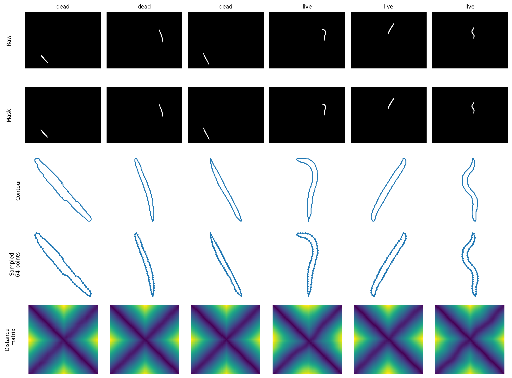

# Saved results

These metrics come from earlier project runs, not fresh full training of the current code. Numeric values are unchanged; personal checkpoint paths were made relative. The JSON records are in [2d/](2d/) and [3d/](3d/), with CSV summaries alongside this file.

## 2D

Logistic-regression macro F1 on frozen embeddings; mean ± standard deviation across five classifier folds:

| Dataset | VAE | AE | MLP decoder |
| --- | ---: | ---: | ---: |
| MNIST | 0.9498 ± 0.0014 | 0.9446 ± 0.0011 | 0.9016 ± 0.0020 |
| BBBC010 | 0.8206 ± 0.0173 | 0.8310 ± 0.0215 | 0.8313 ± 0.0142 |

[Full 2D table](2d_summary.csv). The MNIST VAE/AE use the legacy pipeline, while the MLP decoder uses the main pipeline; their preprocessing, normalization, and decoder implementations differ, so these are not controlled decoder-only comparisons.

Adding the original size norm to BBBC010 embeddings gave macro F1 values of 0.8185 (VAE), 0.8225 (AE), and 0.8254 (MLP decoder). It did not improve F1 in these saved runs.

The evaluation pools training and test embeddings, then cross-validates the classifier without retraining the encoder inside each fold. Classifier test folds can therefore include samples used for unsupervised encoder training. The legacy classifier standardizes inside each fold; the main classifier does not. Fold standard deviations are not uncertainty across independently trained models.

MNIST uses a new 80/20 split of the combined 70,000 images, rather than the official benchmark split. BBBC010 is split by worm image, not grouped by acquisition or well.

The old legacy trainer also used the test partition for checkpoint selection. The current trainer holds out 15% of the training data instead; the old scores retain that limitation. The main 2D trainer selects by training loss. Plotting and deterministic evaluation were also corrected when preparing this repository, so exact reproduction of the old numbers is not guaranteed.

*Individual-worm mask → contour → 64 sampled points → distance matrix. BBBC010 v1, Fred Ausubel / Broad Bioimage Benchmark Collection, CC0.*

## 3D

Four synthetic families: cube, sphere, pyramid, and cylinder. Saved runs used 64 points, latent dimension 128, 350 epochs, and seed 42. The default dataset has 800 examples with an 80/20 split. These are deliberately simple convex shapes.

| Model | Relative latent drift ↓ | Accuracy with reordered test inputs ↑ | Distance reconstruction MSE ↓ |
| --- | ---: | ---: | ---: |
| CNN, both distances | 2.573 | 25.0% | 2.48 × 10⁻⁸ |
| MLP, both distances | 2.438 | 25.6% | 4.36 × 10⁻⁷ |
| Set, both distances | 4.85 × 10⁻⁷ | 100.0% | 2.64 × 10⁻⁸ |
| Set AE, both distances | 4.49 × 10⁻⁷ | 100.0% | 1.08 × 10⁻⁸ |
| Set, Euclidean only | 5.30 × 10⁻⁷ | 100.0% | 2.76 × 10⁻⁸ |
| Set, geodesic only | 9.33 × 10⁻⁷ | 100.0% | 2.80 × 10⁻⁸ |
| Set, matrix decoder + validity penalty | 1.81 × 10⁻⁷ | 100.0% | 1.75 × 10⁻⁵ |
| Set, matrix decoder without validity penalty | 1.55 × 10⁻⁷ | 100.0% | 2.84 × 10⁻⁵ |

[Full 3D table](3d_summary.csv).

Latent drift is the mean ratio `||z_permuted − z_original|| / (||z_original|| + 1e-9)`. Each sample receives an independent point permutation. Accuracy fits a standardized logistic classifier on original-order training embeddings and tests reordered test embeddings; chance is 25%.

The JSON's separate cross-validation accuracy is measured within frozen test embeddings and is 100% for all eight runs. Reconstruction MSE compares sorted pairwise distances, which do not uniquely specify arbitrary geometry; small values also reflect distance normalization. The matrix decoder's Gram-validity residual was `1.11e-6` with the penalty and `9.81e-6` without it. There is one saved run per configuration.

Historical 3D training selected checkpoints by training loss (`--val-frac 0`); the current default reserves 15% for validation. The results demonstrate point-order invariance on this toy dataset, not performance on real scans or arbitrary topology. The original training environment was not fully recorded, and full runs have not been repeated for this repository.

*Decoded interpolation shown as convex hulls, in canonical principal-axis orientation. This is a qualitative example.*
